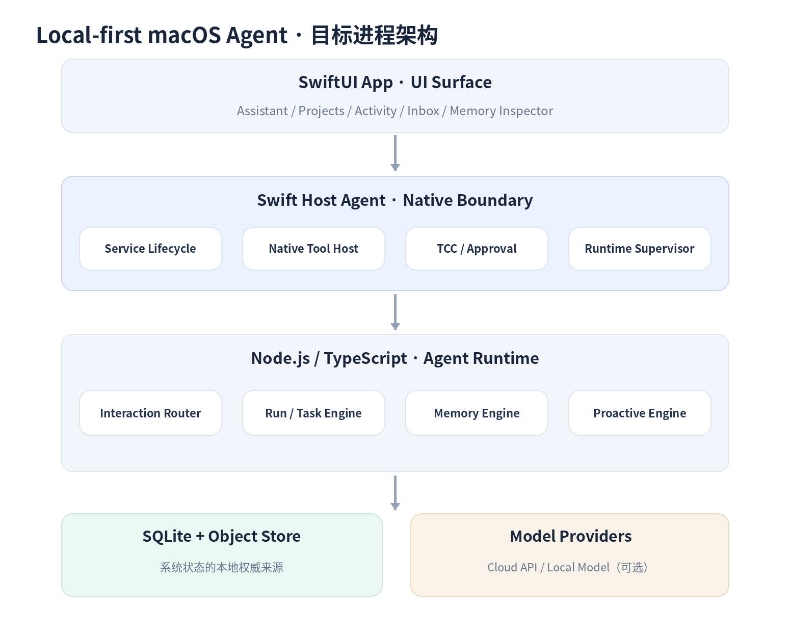
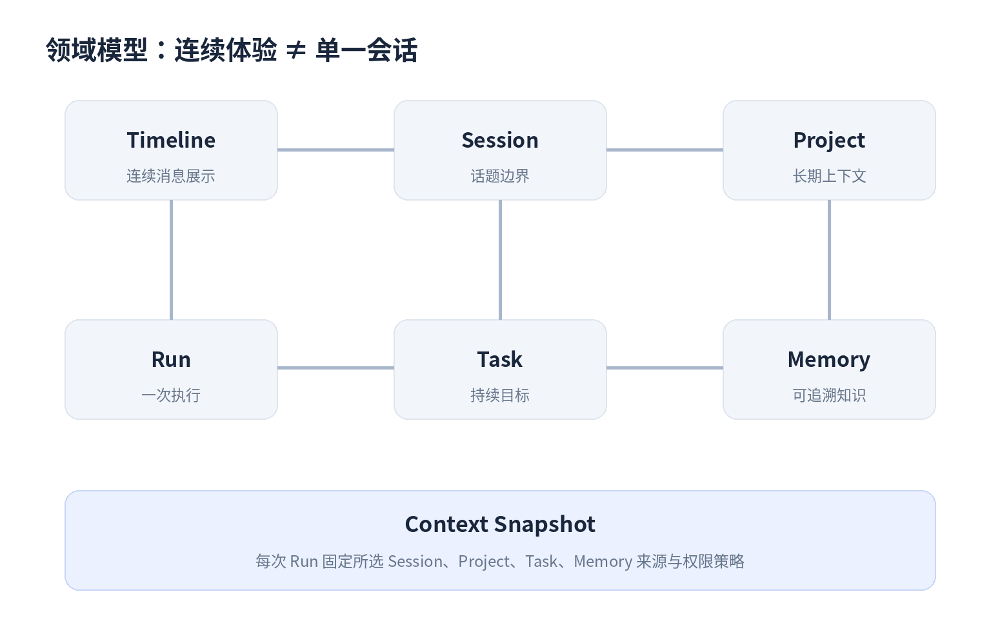
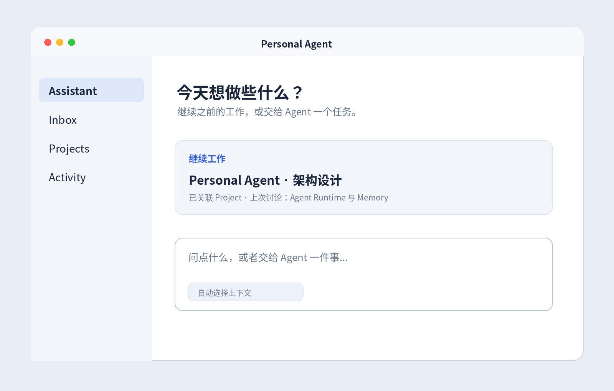
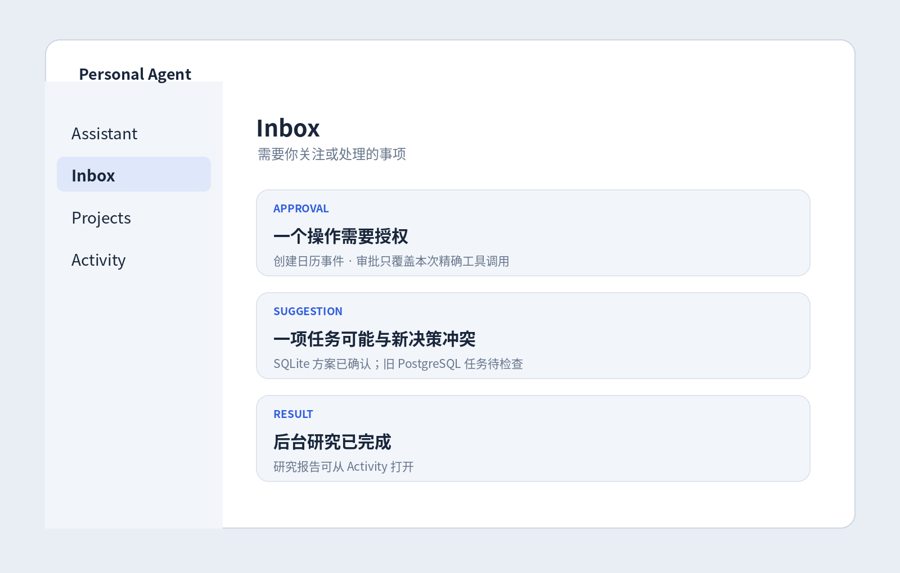
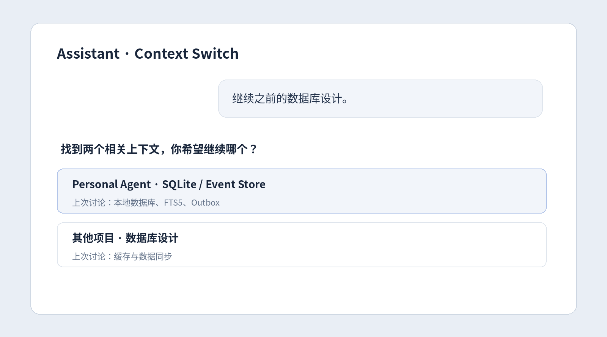
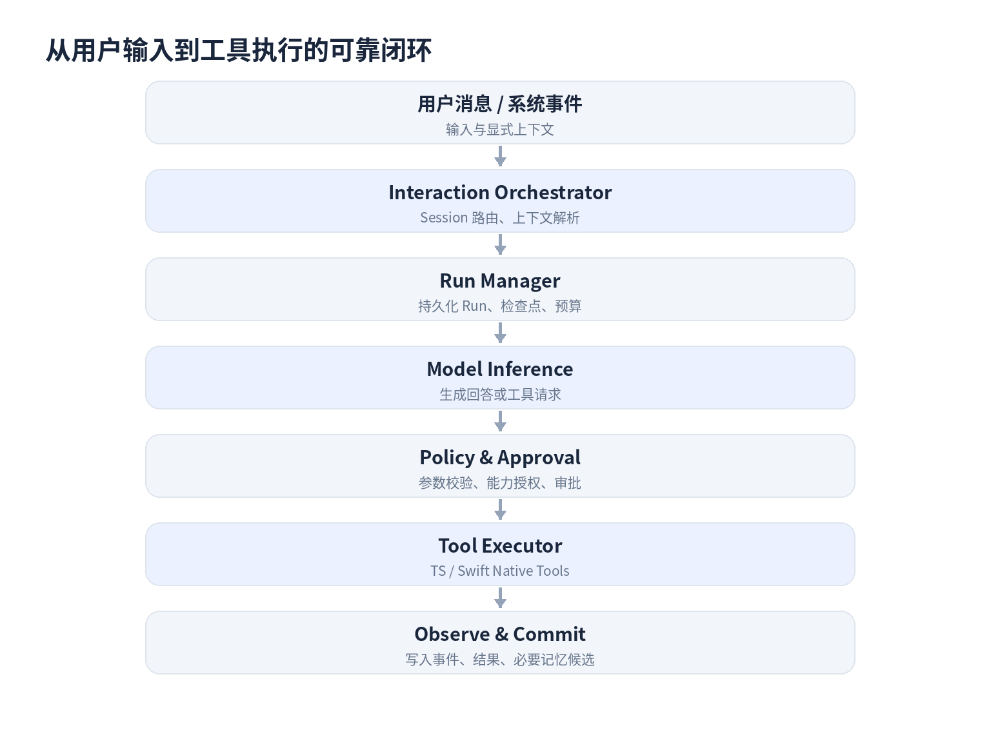
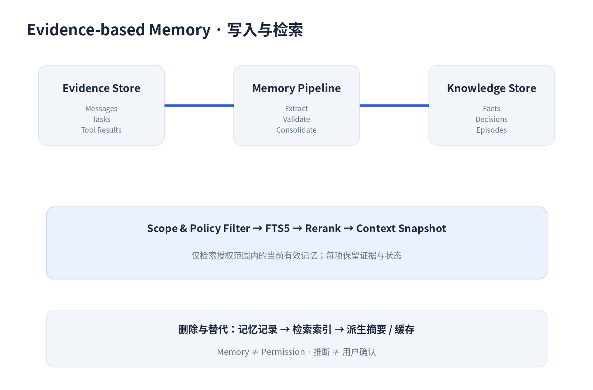

# Personal Agent 产品与技术设计规范

LOCAL-FIRST / MACOS / PERSONAL INTELLIGENCE

Assistant-centric · Automatic Sessions · SwiftUI + TypeScript

v1.0 功能验证开发基线  |  已定稿  |  2026-11-12



图示为后续拆分 Swift Host 的目标架构；Core MVP 使用 §8.1 的 SwiftUI App + App-managed Node 两进程方案。

文档用途：产品设计基线、工程技术方案、Codex 开发实施依据。

状态说明：本文件已定稿为 v1.0 功能验证开发基线，可进入 M0 开发。产品范围及行为以 CONFIRMED 条目为准，工程验证与实施参数见附录 C；定稿不代表对应功能已经实现或验证通过。

## 阅读指南与决策边界

本文件整合此前 v0.1—v0.8 的产品、交互和工程讨论，统一术语、模块职责及 MVP 范围。所有架构图和 UI 原型均为重新绘制的静态示意图，不是应用截图。

| 标识 | 含义 |
| --- | --- |
| CONFIRMED | 产品方向已由讨论明确选择 |
| PROPOSED | 推荐技术实现，开发时可通过 ADR 修订 |
| SPIKE | 必须先做原型验证的技术前提 |
| DEFERRED | 明确不属于 Core MVP 的范围 |

开发执行边界：按 M0 → M1 → M2 → M3 → M4 推进，以阶段验收记录实际结果。附录中的接口及 Schema 是实现方向，不作为可直接投入生产的完整代码；只实现当前阶段所需部分。PROPOSED 实现、库和补丁版本可通过工程验证选定并记录，不再逐项等待产品确认；若必须改变已确认范围或用户可见行为，再说明影响并讨论。独立 Host、发布加固及 MVP+ 能力不作为当前功能验证前置。

## 目录

- 01 产品愿景与范围
- 02 体验模型及信息架构
- 03 核心用户旅程与界面原型
- 04 领域模型与上下文路由
- 05 Agent Runtime / Task / Tool
- 06 Memory Engine
- 07 Proactive / Goal / Inbox
- 08 macOS 进程与 IPC
- 09 数据持久化与安全
- 10 MVP 计划、验收与测试
- 11 风险、待验证事项与 ADR
- 附录 A 接口契约与 Schema 样例
- 附录 B 最小 SQLite 核心 Schema（示例）
- 附录 C 工程验证与实施参数
- 附录 D 定稿时开发环境预检

## 01 产品愿景与范围

### 1.1 产品定义

Personal Agent 是一款以用户自身设备为权威运行环境的 macOS 原生个人智能助手。它通过统一自然语言入口、自动会话管理、长期记忆、持续任务和受控主动建议，协助用户推进生活与工作的长期目标。

### 1.2 核心原则

- Assistant-centric：用户只需表达意图，不必预先创建会话或选择工具。
- Local-first：主要状态和记忆以本地 SQLite 为权威；云模型是可替换的能力提供者。
- 可解释：自动选用的上下文、记忆来源、工具行为和任务状态必须可查看。
- 可纠正：会话归属、项目关联、长期记忆及主动建议均可由用户纠正。
- 可控执行：模型不能绕过工具权限，写操作按风险申请独立授权。
- 渐进自治：先可靠地恢复工作与执行任务，再逐步实现主动性。

### 1.3 成功定义

首个可用版本必须实现：跨天自然语言恢复项目讨论；临时话题不污染原工作；已确认决策跨会话检索且可追溯；受控工具执行可观察、可终止，关闭窗口后继续执行。完整退出应用后停止推进。MVP+ 再验证休眠恢复、独立 Host 服务和基于证据的主动建议。

### 1.4 明确不做

Core MVP 不包含多 Agent 组织、完整桌面自主控制、跨设备同步、动态生成 UI、复杂知识图谱、云端 Worker、联网搜索/网页抓取、复杂文档报告导出或不经配置的自主目标推进。

### 1.5 首版运行平台（CONFIRMED，2026-11-12）

Core MVP 仅支持 Apple Silicon Mac（arm64）；Intel Mac（x86_64）及 Universal Binary 打包列为 DEFERRED。SwiftUI App、原生辅助组件、Node Runtime 及 SQLite 原生依赖均以 arm64 为交付与验收目标。最低 macOS 版本在 M0 根据实际使用的系统 API 和依赖验证后明确，安装说明须标注支持范围。

### 1.6 功能验证期的简化原则（CONFIRMED，2026-11-12）

当前先验证核心功能：SQLite、Snapshot、受管附件及备份包均不增加应用层加密，不设置额外解锁密码、生物识别或备份密码。签名公证、正式分发、沙盒完整适配及加密等后续准备，在功能验证完成后再推进；系统要求的基本运行配置仍按平台要求处理。

普通聊天、模型切换及已选目录内的合规只读操作不增加系统确认弹窗。必要的目录/备份位置选择仅在用户主动操作时触发，复用有效授权，不在启动时集中索取日历、通知、辅助功能或全盘访问权限；权限不足时先在应用内说明，不循环弹窗或自动扩大授权。

验证期应用配置统一落盘到本地 JSON 文件，包括 API Key、协议、URL、模型名及全局默认模型（CONFIRMED，2026-11-12）；完整退出后保留，下次启动加载，无需重复填写 Key。配置文件不加密，Keychain 持久化后置；文件仅允许当前用户读写，Key 不进入上下文、日志、业务数据库或默认备份导出，见 §5.7。

减少弹窗通过交互与阶段收敛实现。参数校验、目录与项目范围、IPC 调用方检查、工具只读限制、凭据脱敏、幂等及恢复前的数据保护继续保留，这些检查不要求增加系统弹窗。系统自身要求的文件访问提示不绕过，也不承诺任何环境下完全无弹窗；网络端点的正常 HTTPS 传输保持不变。

### 1.7 Core MVP 补充默认行为（CONFIRMED，2026-11-12）

| 决策 | 已确认行为 |
| --- | --- |
| 联网搜索 | 首版完成聊天、记忆和本地资料处理，搜索网页及网页抓取后置；云模型 API 正常使用 |
| Project 创建 | 仅用户手动创建或明确口头要求时创建；系统只自动划分 Session，不自动建立 Project |
| 执行中追加消息 | 普通消息按同 Session 顺序排队；明确修改当前任务时创建 Revision，在安全检查点切换 Run |
| 报告与研究结果 | 应用内持久化 Markdown 结果并支持复制；复杂文档文件导出后置 |
| Project 移除 | 默认归档并保留历史；永久删除使用独立操作，先展示影响范围再明确确认 |

## 02 体验模型及信息架构

### 2.1 三层交互模型

Continuous Assistant Timeline 是面向用户的连续消息视图；Topic Session 是底层逻辑话题边界；Context Snapshot 保存 Run 采用的上下文来源版本及实际片段。三者不能混为一体。

Timeline 组织（CONFIRMED，2026-11-12）：Core MVP 的本地数据库只有一份全局 Timeline。Assistant 默认展示授权范围内的连续历史，Project 视图按当前项目归属筛选同一份消息；切换视图不复制消息，不创建独立 Timeline。不同视图保持相同消息 ID 和相对顺序。

Surface 表示窗口或交互表面，不拥有独立消息历史；各 Surface 的 FocusState 独立。共享历史不等于将全部历史送入模型，Context Resolver 仍按 Session / Project / Task、权限及 Context Mode 选择内容；isolated 的历史查询与上下文均按项目范围过滤。



### 2.2 主导航及关键表面

| 入口 | 核心内容 | 首期 |
| --- | --- | --- |
| Assistant | 消息时间线、快速输入、上下文标签、恢复历史、工具审批卡片 | Core MVP |
| Projects | 目标、决策、相关任务、资源、Sessions | Core MVP |
| Activity | Runs、任务执行状态与结果、待审批操作入口 | Core MVP |
| Memory Inspector | 已存事实与决策、证据、编辑删除 | Core MVP |
| Settings | 模型接入、默认模型、手动备份与恢复 | Core MVP |
| Inbox | 集中呈现审批、主动建议、重要后台结果 | MVP+ |
| Quick Assistant | 菜单栏/快捷键轻窗口 | MVP+ |

### 2.3 信息设计原则

Project 可选，不应强制所有输入归属某个项目。Session 默认自动维护但允许查看和显式恢复。Task 脱离 Session 生命周期长期存在；Activity 表达执行事实，并提供相关待审批操作入口；MVP+ 的 Inbox 集中表达需要用户关注的事项。

### 2.4 Project 创建与移除（CONFIRMED，2026-11-12）

用户可在 Projects 手动创建项目，或明确要求“创建一个……项目”；提到新主题只触发 Session 路由，不自动创建 Project，也不要求临时话题先建项目。

默认移除动作标为“归档”，保留消息、Session、Memory、Task 及执行记录，并允许查看和恢复归档项目。归档项目从默认活动列表与自动路由候选中收起，显式打开历史仍可访问；归档不自动取消已有任务，未完成任务继续在 Activity 可见并遵守执行控制规则。

永久删除使用独立入口，在应用内预览受影响的项目记录、历史、记忆、任务及共享引用，用户明确确认范围后才清理；不通过归档按钮隐式删除。不删除外部授权目录或无关项目数据，不删除全局 Timeline；关联片段与共享数据按 §6.5、§9.4 的依赖清理规则处理，影响范围不明确时不执行。

## 03 核心用户旅程与 UI 原型

### 3.1 场景 A：跨天恢复项目

1. 用户在 Project 内明确确认“SwiftUI + TypeScript / Node.js”为当前目标技术栈。
2. Evidence Store 保存原始消息；Memory Engine 创建可追溯 Decision。
3. 中途询问术语含义等短期话题时创建临时 Session，不覆盖原焦点，也不自动创建新 Project。
4. 数天后用户说“继续上次的架构设计”；Router 恢复目标 Session，Context Resolver 只加载相关现行 Decision。
5. 若两个历史 Session 相关性接近，提示候选，由用户选择后再提交路由。

### 3.2 场景 B：后台本地资料整理

1. 用户要求读取已授权项目文档并整理优化建议；Run Manager 判断是否创建持久 Task，并展示预期交付物和完成标准。首版研究范围为本地资料，不调用联网搜索或网页抓取。
2. 执行模型调用、只读工具及检查点写入；需要审批时暂停对应 Run，在 Assistant 展示审批卡片，并可从 Activity 找回同一待审批操作。
3. 用户切换 Session 或关闭主窗口，应用进程及 Node Runtime 保持运行，Task 继续执行，无需启用独立后台服务。
4. Markdown 报告在应用内持久化且满足当前 Task Revision 的完成标准、必要步骤结果已核验时，Task 自动标记完成，无需逐项人工验收；Activity 关联打开同一报告并支持复制，MVP+ 可在 Inbox 展示结果入口。重新打开窗口后从事件序列恢复。
5. 用户完整退出应用时停止推进，保留已持久化进度；退出与重新打开应用的边界见 §8.6。

### 3.3 场景 C：决策变更（Core MVP）与关联任务建议（MVP+）

1. 用户明确将项目存储方案从 PostgreSQL 改为 SQLite。
2. 旧 Decision 标记 superseded，新 Decision 经校验成为 Active。
3. 后续讨论默认使用现行 SQLite 决策，并可追溯来源；用户可在 Memory Inspector 查看 PostgreSQL 旧版本及替代关系。

MVP+ 扩展：Event Store 发出领域变更事件后，Proactive Rule 检查尚未完成的相关 Task；发现“配置 PostgreSQL”待办时生成 Opportunity，去重并放入 Inbox。用户可以忽略或选择查看调整建议，Agent 不自动删除任务。Core MVP 不主动检查关联任务或生成此类建议。

### 3.4 场景 D：纠正错误上下文

系统提示两个候选项目、展示相关证据和上次活动。输入先作为独立 Interaction 持久化，在界面显示“待确认话题”，不归入任何 Session；用户选择后才提交消息归属、绑定 Context 并开始回答。应用重启后恢复待确认输入及选择状态，不自动选择候选。错误关联可在消息顶部通过 Project 标签更改，默认只纠正本次输入及对应回答，不迁移整个 Session，见 §4.7。对于隔离项目不提供未授权的跨项目候选内容。

### 3.5 静态 macOS UI 原型



图 1 · Assistant 主窗口：简化的原生侧栏、持续聊天入口、上下文状态与最近工作。



图 2 · Inbox（MVP+ 原型）：审批、建议和重要结果按不同类型承载；Core MVP 的审批使用 Assistant 卡片与 Activity 入口，见 §5.4。



图 3 · Context Switch：歧义时提示候选，避免静默误切换。

## 04 领域模型与自动上下文路由

### 4.1 领域实体

| 实体 | 作用 | 关键关联 |
| --- | --- | --- |
| Timeline | 单一全局消息历史与排序，供不同视图筛选 | Messages (1:N)，待确认 Interactions |
| Interaction | 已接收的用户输入及路由确认状态 | Timeline，提交后关联一条用户 Message |
| Session | 话题边界、历史恢复 | Messages (1:N), primary Project? |
| Project | 长期目标与上下文范围 | Goals / Tasks / Decisions |
| Task | 长期目标及用户可见工作 | Runs (1:N), origin Session? |
| Run | 一次 Agent 执行尝试 | Context Snapshot, Steps |
| Memory | 来源支持的知识 | Evidence + Scope |
| Event | 状态变更的持久记录 | Aggregate / Correlation |
| Opportunity | 尚未执行的主动建议候选 | Events / Inbox / Task? |

### 4.2 Session 与 Focus 分离

Session 持久化状态仅需 open / archived；当前激活哪段讨论属于 per-surface FocusState，而不是 Session 生命周期。FocusState 包含 activeSessionId、activeProjectId、interruptedSessionId、recentSessionIds、contextMode 和乐观锁版本。消息变更共享给所有相关视图，焦点操作仅更新发起或确认操作的当前 Surface，不改变其他窗口焦点；Surface 不作为 Timeline ID。

### 4.3 路由动作与优先级

| 动作 | 条件 | 系统处理 |
| --- | --- | --- |
| CONTINUE | 当前主题连续 | 复用当前 Session |
| RESUME | 显式或可靠的历史恢复 | 选定历史 Session |
| CREATE | 独立新话题 | 新建 Topic Session |
| CLARIFY | 候选得分接近、歧义重要 | Interaction 保持待确认，展示选择项，不绑定 Session/Context |

决策优先级：显式 Session/Project/Task → 显式恢复 → 当前话题连续 → 临时插话识别 → 候选语义检索 → 澄清。所有候选与路由动作须先满足当前授权及 Context Mode 的范围约束；显式恢复意图不允许路由器静默扩大 isolated 范围，跨项目继续工作须由用户显式切换项目或模式。综合候选分数、候选差距和切换成本，不把 LLM 的自报置信度当作真实校准概率。

### 4.4 Context Resolver

Route Commit 后依据 Context Mode 解析允许的 global/project/session/task 作用域，先权限过滤，再基于结构化过滤、FTS5 和可选的语义检索获得证据；isolated 不自动包含 global 作用域，见 §4.5。按来源可信度、时效性、当前意图与 token 预算排序，形成记录 Context Mode 的不可变 Context Snapshot。权限在工具实际执行前再次验证；Snapshot 固定不意味着永久授权。

Snapshot 内容（CONFIRMED，2026-11-12）：保存来源类型、ID、来源版本、来源项目及实际采用的上下文片段，按送入模型的顺序排列。片段为范围过滤、脱敏及 token 预算裁剪后的内容，不复制未采用的完整原文；来源无稳定版本号时，以采集时的内容哈希标识版本。查看历史 Run 时读取快照片段，不以来源对象的最新内容替换。

Run 保存初始 Snapshot 引用；后续模型调用若新增工具结果或改变选用内容，应生成新 Snapshot 并由对应 RunStep 引用，不覆盖旧快照。只保存外部可观察的输入内容与来源，不要求获取或保存模型不可见的内部推理，API Key 不进入快照。

不可变约束适用于正常更新：修改原始消息、Memory 或资源不改写既有快照。实际片段默认随关联历史保留，见 §9.4；用户删除/Forget 时仍按 §6.5、§9.4 清理对应片段及派生副本，保留最小删除标记并显示“内容已删除，无法还原”，不得从原始证据或其他副本自动补回。查看历史快照及构建新上下文时均重新检查当前权限与范围，历史快照不赋予访问权。

### 4.5 Context Mode

| Mode | 行为 |
| --- | --- |
| automatic | 默认自动选择相关 Project 与 Memory |
| pinned | 用户固定项目；新话题不静默切到另一个项目 |
| isolated | 默认不使用全局记忆，仅使用当前项目内的内容及用户本次显式提供的信息；模型接入与其他模式一致，资源访问仍须通过工具权限策略 |

isolated 记忆边界（CONFIRMED，2026-11-12）：隔离模式须绑定明确 Project；项目未确定时保持待确认，不回退到全局检索。全局偏好、个人资料、Procedure、摘要及其他全局记忆均不自动继承；其他项目内容也不得自动混入。

此边界同时约束路由候选查询、候选说明、记忆检索及 Context 构建；不得借助缓存、混合 Timeline 历史或旧 Snapshot 带入范围外内容。当前项目内的 Session/Task 历史仍按其实际内容范围、权限和证据有效性过滤，不因关联当前项目就无条件加载。

用户本次显式提供的信息可在本次交互中使用，但不因此取得访问其他项目或自动保存长期记忆的额外权限。应用级安全规则与工具权限策略继续生效，不属于被排除的全局记忆。

模型使用边界（CONFIRMED，2026-11-12）：所有 Context Mode 共用 §5.7 的模型接入配置，isolated 不要求本地模型，也不增加单独的项目级模型授权；该模式限制实际送入模型的上下文来源。模型输入仍须经过数据最小化、范围过滤及凭据脱敏。

### 4.6 实现注意

待确认输入采用独立 Interaction（CONFIRMED，2026-11-12），不创建临时 Session，不向 messages 写入无 Session 的占位消息。处理分为三个阶段：

1. 接收：在同一事务保存原始 InteractionInput、幂等键和路由处理 Outbox，并从全局 Timeline 预留 sequence，状态为 received。重复提交返回同一 Interaction；相同幂等键携带不同输入时拒绝请求。
2. 等待选择：遇到 CLARIFY 时，持久化候选、原因及 Interaction 版本，状态改为 waiting_route；不改变 Focus，不构建业务 Context Snapshot/Run，不执行任务工具或提取长期记忆。候选查询与展示仍须先经过权限过滤。
3. 路由提交：明确路由或用户选择后，重新检查目标权限、Interaction 版本及当前 Surface 的 Focus 乐观锁版本；在单一事务中创建或关联 Session、以预留 sequence 写入唯一用户 Message、记录 Interaction 当前项目归属、更新当前 Surface 的 Focus、将 Interaction 标记 committed，并写入 Context 构建与 Run 入队 Outbox。Session 可自动创建，Project 只按 §2.4 的明确用户意图创建。重复确认不得产生重复消息、Session 或 Run；候选失效或版本冲突时重新确认，不静默覆盖。

界面按 Interaction ID 将待确认输入更新为已提交消息，不重复展示或改变其原有顺序。未归属输入可从 Assistant 或发起 Surface 的待确认区域找回，不提前进入任一项目的已提交历史。应用重启后恢复 received / waiting_route 记录，等待用户继续处理，不自动提交候选。Context 构建和 Run 入队为可恢复异步阶段，利用 persisted job/outbox，避免已提交消息丢失执行；完整退出后的执行仍受 §8.6 手动恢复约束。

用户消息通过 Interaction 关联当前归属，模型回答通过 Run 追溯到原 Interaction。Project 筛选采用交互当前归属，不仅依赖 Session 的 primary Project；归属纠正不改变全局 Timeline ID、消息 ID 或 sequence。旧回答及 Snapshot 可否进入新上下文仍按实际来源范围检查，不因展示归属变化而绕过隔离。

### 4.7 已提交交互的归属纠正（CONFIRMED，2026-11-12）

用户更改某次交互的 Project 标签时，默认仅调整该 Interaction 对应的用户输入及回答的归属，不迁移整个 Session，不改变其他交互或关联 Task 的归属。整段 Session 迁移不包含在本次纠正操作中。

当前归属与历史执行上下文分开记录：保留原 Run、Context Snapshot 和工具执行记录，不将历史执行证据改写为使用了目标项目的上下文。归属纠正不代表已发生的外部操作被撤销，也不授予在目标项目继续执行的权限。

纠正时重新验证目标项目访问权限，以 Interaction 版本防止过时提交；归属变更及包含原归属、目标归属的纠正事件在同一事务持久化。不得通过修改整个 Session 的 primary Project 实现单次交互纠正；消息 ID 和 Timeline 顺序保持稳定，界面需能查看原执行上下文及纠正记录。

纠正后的执行策略（CONFIRMED，2026-11-12）：停止旧 Run 继续派发新步骤，保留已有结果；不自动重新回答。归属纠正与停止派发标记在同一事务持久化，执行入口检查当前 Interaction 版本及 Run 状态，防止旧队列任务继续执行。尚未终止的旧 Run 按取消流程终止；已终止的 Run 保留原状态。

旧 Run 在途请求尽力取消，迟到结果仅归入原执行记录，不触发后续步骤或覆盖新 Run 的结果；未消费的旧审批失效，不用于新 Run。已经发生的外部操作及结果未知的调用仍按 §5.5 处理，不因纠正归属或创建新 Run 而自动重放副作用调用。

界面保留原回答并标明其实际使用的项目上下文，提供“重新处理”入口。用户点击后重新检查目标权限、当前归属及必要审批，构建新的 Context Snapshot 并创建新 Run，关联原 Interaction，不重复创建用户输入；不得修改旧 Snapshot 或将旧 Run 切换到新项目继续执行。重复点击不得创建重复的新尝试。

派生 Memory 自动暂停使用、保留证据，并在用户重新处理时按新项目重新提取与校验，具体规则见 §6.7。

## 05 Agent Runtime、Task 与 Tool

### 5.1 Unified Run Model

每次完成路由提交的交互生成 Run；received / waiting_route 的 Interaction 尚未形成业务 Run。只有多步骤、可持续、定时或需要长期跟踪的工作才创建 Task。Task 是持续目标，Run 是一次执行尝试。Task 可跨 Session、跨天存续，同一 Task 可出现多个 Run 与 Revision。

Task 完成规则（CONFIRMED，2026-11-12）：满足事先可见的交付标准后自动完成，不设置每个任务必经的人工“待验收”阶段。创建或修改 Task 时，根据用户请求保存并展示当前 Revision 的预期交付物及完成标准；要求存在重要歧义时先澄清，不自行补充未提出的要求。

完成判定须同时满足：交付物已持久化且用户可访问、当前 Revision 的全部完成标准已满足、必要执行步骤的结果已核验。Agent 对照标准评估内容并提供可查看的完成依据，执行器检查产物引用及必需步骤状态；不得仅凭模型声称“完成”或某个 Run 正常结束就将 Task 标记完成。必要步骤失败、结果 unknown 或仍有未决审批时保持未完成，并展示原因及缺项。

完成状态、产物引用与完成依据在同一事务提交，并检查 Task Revision，旧 Run 的迟到结果不能完成较新的 Revision。Run completed 只表示一次执行尝试结束，不等于 Task 已完成；此前失败的尝试已被安全解决后，不阻止当前 Revision 按标准完成。

用户仍可要求修改已完成的交付物；明确修改同一 Task 时创建新 Revision 和新 Run，重新评估完成标准，保留此前版本的产物及完成记录。追加要求不静默改写旧版本的完成依据，也不代表原有工具审批可复用。

交付物呈现（CONFIRMED，2026-11-12）：首版报告采用应用内 Markdown，最终结果可复用已持久化的 assistant Message，Task 的 result_ref 指向该消息，Activity 打开同一内容并支持复制；不另建一份可分叉编辑的报告。修改后由新 Revision 指向新的结果，旧结果保留。按 Markdown 文本渲染并保留来源引用，不执行内嵌脚本或自动加载远程资源；Word/PDF 等复杂文档报告导出后置，不写入用户原始项目文件。



### 5.2 Run 状态和执行步骤

Run: queued → running → waiting_approval / paused → running → completed / failed / cancelled。终止状态不得回到 running；新尝试创建新的 Run。RunStep 记录 model/tool/approval/checkpoint 等可观察步骤，不需要保存模型不可见的内部推理。

因完整退出应用而中断或尚未执行的工作，重新打开应用后等待用户手动恢复，不因 Runtime 或 Worker 启动自动派发，见 §8.6。

因归属纠正而停止的旧 Run 不再恢复执行；用户手动“重新处理”时按 §4.7 创建新 Run 和 Context Snapshot。

预算耗尽属于可恢复的 paused 状态，按 §5.9 保留原 Run 与进度，不标记为模型请求失败；继续前须由用户明确追加预算。

### 5.3 Tool Registry 与权限

Tool 定义应包含 name、version、inputSchema、requiredCapabilities、sideEffectClass、riskLevel、timeout、idempotencyStrategy 和 execute。执行器入口统一进行参数校验、策略评估、权限检查、预算、审计。Swift Native Bridge 在 Core MVP 先提供 §5.8 的授权目录文件读取，EventKit、通知等能力后续扩展；TS Runner 负责模型 API 与业务编排，联网搜索及网页抓取工具后置。用户请求实时网络资料时明确说明首版范围，可改为由用户提供文本或本地文件，不将模型已有知识冒充实时搜索结果。

### 5.4 审批

ApprovalRequest 绑定 Invocation ID、工具版本、规范化参数哈希、权限范围、有效期及请求主体。“已查看”不同于“批准”；审批之后执行前再次验证资源及授权。MVP 先只支持批准一次；复杂持续授权延后。

Core MVP 审批入口（CONFIRMED，2026-11-12）：Assistant 内展示审批卡片，Activity 提供待审批操作入口，不提前引入完整 Inbox。卡片展示工具名称、目标资源、关键参数及预期影响，并提供“批准一次”和“拒绝”操作。

Assistant 与 Activity 指向同一 ApprovalRequest，共享审批状态；同一请求只能批准执行一次，拒绝、过期或失效的请求不得执行工具。切换 Session、关闭窗口或查看卡片均不代表批准；窗口关闭期间需要审批时，相关 Run 保持 waiting_approval，重新打开窗口后可从 Activity 找回。完整退出后仍遵守 §8.6 的手动恢复规则，恢复任务不代替审批。

审批交互使用应用内卡片，不额外叠加系统模态确认；已选目录内符合授权范围的普通只读不逐文件重复询问。需要重新选择目录时先展示应用内入口，由用户触发原生选择界面。

### 5.5 幂等和故障恢复

ToolInvocation 先持久化意图，再执行外部副作用并记录结果。网络超时可能发生在外部动作已成功之后；不支持幂等键的工具必须查询执行结果或标记 unknown 请求人工处理，禁止盲目重试。SQLite 只能保证本地原子状态，不能对所有外部系统保证 exactly-once。

### 5.6 调度与并发

Foreground 高优先级；不同 Session 的独立 Run 可在限额内并行。同一 Session 的普通消息按接收顺序串行排队，显示排队状态，不将新输入注入正在执行的旧 Run；同一外部资源写操作应加锁。

执行中追加消息（CONFIRMED，2026-11-12）：普通后续消息不打断旧 Run；明确要求修改当前 Task 时先创建 Task Revision、停止旧计划继续派发新步骤，再在安全检查点切换新 Run，并核验旧在途操作。停止/取消请求优先处理，不排在普通消息后等待。等待审批或预算暂停不会因下一条普通消息而隐式解除；Project 归属纠正仍遵守 §4.7 的手动重新处理规则。

排队 Run 在真正开始执行前构建并绑定 Context Snapshot；进入 running 前必须具备有效快照。按 Session / Interaction 的因果顺序纳入本轮输入及已完成的前序结果，排除后序排队输入，不直接把全局 Timeline 的显示顺序当作模型对话顺序，也不在排队时提前固定缺少前序结果的快照。模型选择仍在 Run 创建时绑定，等待期间不随全局默认改变。

后序排队输入的自动记忆提取同样等待其轮到处理，避免提前入库或替代决策而影响前序 Run；明确修改当前任务的控制消息按上述 Revision 路径处理。

### 5.7 模型接入与配置（CONFIRMED，2026-11-12）

模型接入统一支持 OpenAI 兼容协议与 Anthropic 兼容协议，不按 Context Mode 区分可用模型。允许配置多个接入项，每个接入项包含以下用户配置：

| 配置项 | 含义 |
| --- | --- |
| protocol | openai / anthropic，用于选择协议族 |
| apiType | openai 下选择 chat_completions / responses；anthropic 固定为 messages，无需额外选择 |
| url | 自定义 API Base URL，不绑定官方域名；界面按协议说明版本前缀和请求路径的拼接规则 |
| key | 验证期直接保存于本地配置文件，退出后保留；不使用 Keychain，不要求额外解锁 |
| modelNames | 一个或多个非空模型名，按用户填写的原始名称调用，不依赖预置模型白名单或自动发现接口 |

调用时以接入项 ID + model_name 标识模型，避免不同 URL 或 API 类型下的同名模型混淆。保存时校验 URL 格式、protocol 与 apiType 的合法组合及模型名列表；Key 仅保存在本地配置文件，不进入 SQLite、上下文、默认备份导出或日志，仅发送给该接入项指定的端点，不随跨源重定向转发。已有 Run 的绑定目标与当前接入配置不一致时明确阻塞，不将新配置的 Key 用于旧端点。

配置文件（CONFIRMED，2026-11-12）：使用 `~/Library/Application Support/Tandem/config.json` 作为应用配置的唯一持久化来源，Settings 通过 Node 的配置读写入口修改同一文件。模型接入、默认模型及后续需要的应用级设置均落该文件；消息、任务、记忆、授权状态及 Run 的实际预算消耗仍作为业务状态保存在 SQLite，不与配置混存。具体配置字段按需增加，不引入通用配置框架。

配置目录权限为 0700，文件及保存用临时文件为 0600，不放入项目仓库。保存先校验，再在同目录写临时文件并原子替换；失败保留旧文件。启动读取配置，Settings 保存成功后更新当前配置；手工编辑文件重启后生效，首版不增加文件监听。无效 JSON、未知配置版本或外部修改冲突时应用内提示修复/重载，不自动覆盖为默认值；错误信息只显示字段位置或行列，不回显含 Key 的原文。

最小配置示例（占位 Key，不是真实凭据）：

```json
{
  "schemaVersion": 1,
  "modelConnections": [
    {
      "id": "primary",
      "protocol": "openai",
      "apiType": "responses",
      "url": "https://api.example.com/v1",
      "key": "YOUR_API_KEY",
      "modelNames": ["your-model"]
    }
  ],
  "defaultModel": {
    "connectionId": "primary",
    "modelName": "your-model"
  }
}
```

模型选择（CONFIRMED，2026-11-12）：设置并持久化一个全局默认模型，值为接入项 ID + model_name；允许用户手动选择其他已配置模型，显式选择优先于全局默认。不按任务类型自动选择模型，所有 Context Mode 使用相同选择规则。尚未设置默认模型或所选配置已失效时提示用户选择，不静默使用列表中的第一个模型。

新 Run 创建时绑定所选接入项及模型名，并记录实际使用的协议、API 类型和 URL，不保存明文 Key；后续切换模型或修改全局默认只影响新 Run，不改变已创建 Run 的执行目标及历史记录。原接入配置不可用时明确报告，不能通过解析新的默认值静默替换该 Run 的目标。

协议适配负责文本生成、流式输出、工具调用与错误转换，工具执行仍经过统一 Policy Engine。兼容端点是否支持所需流式或工具能力须实际验证；不支持时明确报错，不将文本伪装成工具调用。

失败处理（CONFIRMED，2026-11-12）：模型请求失败后显示错误，保留已有执行步骤及未完成输出并明确标注失败，等待用户选择“重试”或手动切换模型；不自动重试或切换其他模型，协议适配及 SDK 的重试设置须与此一致。

因预算耗尽而主动停止请求时，按 §5.9 暂停，不进入模型故障重试流程。

失败 Run 保持终止状态，用户重试时按 §5.2 创建关联原交互的新 Run，不重复创建用户输入；默认重试原接入项及模型，用户显式换模型时绑定新的选择，不因全局默认已改变而静默改用其他模型。重新检查当前权限、接入配置及上下文有效性，重复点击不创建重复尝试。重试不自动重放已完成或结果未知的副作用工具调用，仍按 §5.5 核验并遵守单次审批约束。

首版 API 范围（CONFIRMED，2026-11-12）：同时支持 OpenAI Chat Completions、OpenAI Responses 和 Anthropic Messages。每个接入项明确绑定一种 API 类型；同一 URL 需要使用两种 OpenAI API 时，可分别配置接入项。按配置调用，不自动探测、降级或切换 API 类型。

三种 API 分别适配输入结构、文本输出、流式事件、函数调用及结果关联，再归一为统一的 Run/Tool 执行步骤。Responses 需按类型处理 output Items 及流式事件，并保留函数调用与工具结果的 call_id 对应关系；所有实际工具调用仍经过本地 Registry、审批及权限检查。

上下文继续以本地 Context Snapshot 为依据，不依赖远端会话作为状态权威；不得借助远端响应链带入未被本次 Snapshot 允许的上下文。支持 Responses 不同时引入远端托管工具等额外产品能力。协议参考：[OpenAI Chat Completions](https://developers.openai.com/api/reference/resources/chat/subresources/completions/methods/create)、[OpenAI Responses 适配说明](https://developers.openai.com/api/docs/guides/migrate-to-responses)、[Anthropic Messages](https://platform.claude.com/docs/en/api/messages/create)。

### 5.8 Core MVP 原生文件读取（CONFIRMED，2026-11-12）

首个 Native Tool 采用用户授权目录内的文件读取，用于基于项目资料讨论、检索及形成可追溯证据。日历读取不列为 Core MVP 的交付与验收要求。用户通过原生目录选择界面确定授权范围，Swift 侧持有并校验目录授权；Node 通过 Native Bridge 请求读取，不接受模型自行声明的目录授权。

文件格式（CONFIRMED，2026-11-12）：首版仅支持 UTF-8 纯文本，包括 Markdown、TXT、代码、JSON 等；支持 UTF-8 BOM，不自动猜测或转换其他编码。代码及 JSON 按文本读取，不执行代码，也不要求先解析为语法树或业务对象。PDF、Word、扫描件 OCR 及其他二进制文档提取不纳入 Core MVP。

读取时同时检查内容与编码，不仅依赖扩展名；非法 UTF-8、检测出的二进制内容和不支持的文档格式分别返回明确错误，不以替换字符或乱码冒充成功。文件正文作为不可信资料处理，其中的命令、角色声明或授权文字不能代替用户指令、工具权限及决策确认。

读取请求绑定授权标识和目录内相对路径，执行前再次校验授权有效性、项目范围及只读能力。实际打开文件时防止父目录跳转、目录同名前缀误判、符号链接越界及校验后资源被替换；对实际打开的对象确认范围后再读取，不仅依赖路径字符串前缀判断。只处理普通文件，拒绝设备、管道等特殊文件。

工具按请求有界枚举或读取，设置大小、条目数和超时上限；超限、权限失效、文件不存在、格式不支持及读取中变化须返回明确状态，不伪装为完整内容。不能创建、修改、删除或移动源文件。目录授权不等于自动全量导入、长期记忆写入或跨项目读取；内容进入模型前仍遵守 Context Mode、数据最小化及凭据过滤。

结果携带资源标识、相对路径、读取版本或内容哈希、实际读取的行号范围及截断/失败状态，作为 Evidence 和后续模型步骤的 Snapshot 来源。截断在完整 UTF-8 字符边界处理并明确标注未读完，不把部分内容当作完整文件；引用保留原文件行号及版本定位。大小、枚举条目数及超时上限作为工程参数在工具 Spike 中验证确定。

验证期先验证用户主动选择普通项目目录、复用有效的应用级授权、失效与撤销行为，不反复弹出系统授权。跨重启原生授权恢复及 security-scoped bookmark 的完整适配，结合后续签名与沙盒方案验证；失效时展示重新选择入口，不自动扩大范围。系统文件权限以 macOS 实际要求为准。参考：[Apple 文件访问与授权说明](https://developer.apple.com/documentation/security/accessing-files-from-the-macos-app-sandbox)。

### 5.9 执行预算与暂停（CONFIRMED，2026-11-12）

每个 Run 持久化步骤数、累计 token、活跃运行时长的上限及已用量。执行步骤按模型请求或工具调用计数；活跃时长累计 running 期间的时间，包括请求等待，不计 paused / waiting_approval 期间。模型 usage 可用时记录实际值，缺失时保守估算并标注，不能当作零消耗；具体默认上限通过 Runtime Spike 确定。

派发前检查并预留相应预算，触及任一上限即停止新步骤，将 Run 置为 paused、pauseReason=budget_exhausted，并持久化检查点、累计消耗及触顶原因。不得自动追加额度、创建新 Run 或通过重启清零来继续推进。预算暂停本身不代表 Task 失败或完成。

在途请求尽力取消，已发生的消耗及可确认结果仍记入原 Run；无法撤销的外部操作或 unknown 结果按 §5.5 核验。预算控制以阻止新调用和限制请求生成量为边界，不承诺收回已消耗 token 或撤销在途操作。

Assistant / Activity 展示触顶原因、已用量与上限、已有产物及未完成项。只有用户明确追加预算并选择“继续”后，才允许原 Run 从安全检查点恢复；追加上限而非重置已用量，追加后仍不足时继续保持暂停。追加操作需校验当前版本并幂等处理，模型不能自行执行。

恢复前重新核验权限、审批有效性、Task Revision、上下文与未确认的工具结果；保留原模型绑定，不重放已完成步骤。配置或上下文已失效时展示阻塞原因；需要换模型或重新处理时遵守既有新 Run 规则，不静默转换。应用重开后仍保留耗尽原因与计数，仅点击普通恢复入口不能绕过追加预算要求。

## 06 Evidence-based Memory Engine

### 6.1 三层记忆结构



Evidence Store 保存用户消息、任务事件、文档和工具输出；Memory Pipeline 提取、验证、去重与冲突处理；Knowledge Store 保存 Fact、Preference、Decision、Episode、Procedure。Working Context 属于当前 Run，不直接视为长期记忆。

### 6.2 Memory 候选写入策略

| 信息来源/类型 | 默认行为 |
| --- | --- |
| 用户明确确认 Decision | 提取、校验范围与来源，保存 confirmed |
| 用户直接陈述的普通事实 | 有长期价值、作用域明确且非敏感时自动保存，保留来源并支持撤销 |
| 假设、示例、转述或引用 | 不作为用户自身事实直接保存；来源不明时保留为候选 |
| 模型推断的偏好 | 标记 inferred/unconfirmed，不升级为用户确认 |
| 候选架构方案 | 保留为历史讨论，不自动形成 active Decision |
| 敏感信息 | 默认限制自动长期保存；明确授权后处理 |
| 与现行 Decision 冲突 | 根据 subject/predicate/scope/valid time 审核；普通事实或推断不能自动覆盖已确认 Decision，替代须有用户明确确认 |
| 证据所属交互被纠正项目归属 | 暂停受影响记忆的使用并核验其他证据，不直接迁移到目标项目，见 §6.7 |
| 命中用户遗忘标记 | 阻止从原有证据及其派生副本重新提取或激活该记忆，见 §6.5 |

普通事实自动保存（CONFIRMED，2026-11-12）：仅适用于用户直接陈述、有长期价值、作用域明确的非敏感事实，例如“我平时主要用 Swift 开发”。一次性闲聊、假设、示例、引用、模型推断及文件或工具中的陈述，不因出现在对话中就获得此直接入库许可；条件不明确时保留候选，不强行长期保存。

自动保存记录须关联原始用户消息、有效作用域及适用时间，在 Memory Inspector 标明“自动保存 / 用户陈述来源”，可查看证据、修正或撤销。自动保存不等于用户在应用中确认，不伪造 confirmedAt，也不自动升级为已确认 Decision；通过来源与作用域校验的普通事实可供后续检索使用。

不为了增加复用而将项目事实提升为全局记忆，作用域不明时不直接入库。与已确认决策冲突时保留冲突信息，等待用户明确确认；敏感信息、凭据、遗忘标记及归属纠正后的证据失效规则始终优先。用户撤销自动保存时复用 §6.5 的遗忘流程，避免同一原证据立即重新生成该记忆。

提取若使用模型，复用统一模型选择、失败处理与执行预算规则，不以后台处理为由绕过暂停、退出或手动恢复边界，也不进行无预算的自动重试。

### 6.3 Decision 版本机制

Decision 使用规范化 decisionKey，并保留 rationale、sourceMessageIds、confirmedAt、supersedesId、status。新决策替代旧决策时，旧版本保留证据但不再作为当前方案优先检索。不同项目或不同用途的数据库选择不构成自动冲突。

Core MVP 决策变更范围（CONFIRMED，2026-11-12）：保存用户明确确认的新决策、替代旧版本、保留历史与证据；后续讨论默认采用现行版本，旧版本仅作为明确标注的历史信息使用。主动检查关联 Task 并提出调整建议留到 MVP+；决策变更本身不自动修改或删除 Task。

### 6.4 检索路径

授权作用域与证据有效性过滤 → Structured Query + FTS5 → 可选向量召回 → 合并去重 → 时效/可信度 Rerank → Token Budget → Context Items（带来源）。待核验或证据已失效的记忆不得作为现行知识进入上下文；索引命中和缓存不能绕过此检查。Core MVP 使用 SQLite + FTS5；本地 embedding 和复杂关系检索列为后续优化。

### 6.5 Memory Inspector 与删除

允许查看、确认、修正、撤销、删除重要记忆，并导航原始证据。Forget 不等于 Archive：需要清理 FTS、Embedding、缓存、派生摘要和持久化上下文副本；云端已处理的数据遵守对应提供商的保留政策，不承诺本地删除即可撤回远端副本。

遗忘后的再提取策略（CONFIRMED，2026-11-12）：用户删除/Forget 一条记忆时，保留独立的遗忘标记，阻止从原有证据及其派生副本自动重新生成该记忆，直到用户明确选择“允许重新记住”。模型、后台提取、重新索引、归属纠正或重新处理均不能自行解除标记。

标记仅保存作用域、规范化记忆键摘要、被阻止的原有证据标识及创建/解除时间等最小抑制信息，不保存被删除的记忆正文；与 Memory 记录独立，不因删除 Memory 或普通缓存清理而消失。匹配沿用记忆去重的规范化键与证据来源链，不能仅按旧 memoryId 判断，避免生成新 ID 或更换措辞后重新写入同一记忆。该规则约束原有证据及其派生链，不自动扩展为针对所有未来独立来源的全局禁记规则。

遗忘标记、生效后的记忆不可用状态及清理 Outbox 在同一事务持久化；Memory Pipeline 在提取前及提交前检查标记，拒绝在删除前启动但在删除后完成的旧任务。用户明确解除标记后，重新提取仍须经过来源、作用域、确认状态及冲突校验，不直接恢复旧记录。

本项控制长期记忆的再次生成，不自动删除原聊天；原聊天的查看与使用仍受既有权限及上下文范围规则约束。需要删除原始证据时，用户可另行删除源数据，并按 §9.4 清理关联副本。

### 6.6 Memory 不赋予权限

用户偏好或 Procedure 只可指导行为，不能代替真实的 Tool Grant。任何可能修改本地文件或发送信息的动作都必须再次通过 Policy Engine。

### 6.7 归属纠正后的记忆处理（CONFIRMED，2026-11-12）

采用自动暂停使用策略：按 Evidence 依赖定位受影响记忆及派生摘要，将纠正交互在原项目下的证据支持关系标记为不可用或待核验，暂停受影响内容进入后续检索与新 Context。原始证据、记忆历史及纠正原因保留，可在 Memory Inspector 查看；不直接迁移旧记忆或其 confirmed 状态到目标项目。

记忆若仅由该错误归属证据支持，则保持停用；若还有其他独立有效证据，须重新校验其内容、作用域及确认状态后才能继续使用。无关记忆不受影响；无法确定现行决策时显示缺失或请求澄清，不自动用旧版本补位。

归属纠正事务同时持久化证据失效或待核验标记及清理 Outbox，确保纠正提交后即阻止使用受影响内容，不等待异步索引、缓存和派生摘要清理完成。Memory Pipeline 提交前检查来源 Interaction 版本与当前归属，拒绝旧提取任务或旧 Run 的迟到结果在原项目重新激活这些记忆。历史 Context Snapshot 保留用于审计，不作为绕过失效检查的新上下文来源。

用户按 §4.7 点击“重新处理”后，才在目标项目重新提取并按 §6.2、§6.3 校验。纠正归属或重新处理本身不等于确认新的 Decision；与目标项目现行决策冲突或来源不足的候选不得自动成为现行决策。

## 07 Proactive Engine / Goal / Inbox

### 7.1 事件驱动主动性

授权事件源 → Normalizer/去重 → Rules → Goal Resolver → Opportunity Evaluation → Interruption Policy → Ignore / Inbox / 受控 Task。Proactive Engine 不直接调用系统修改工具，所有实际动作复用统一 Run/Tool Policy。

### 7.2 领域区分

| 对象 | 意义 |
| --- | --- |
| Goal | 明确的成功条件与持续目标，非强制输入 |
| Event | 真实发生的变化，带来源 |
| Opportunity | 潜在可行动价值，尚未决定是否展示 |
| Inbox Item | 等待用户关注的具体条目 |
| Task/Run | 真正执行与审计的单位 |

### 7.3 主动级别

L1 Observe：在授权范围内静默维护；L2 Suggest：有证据的建议进入 Inbox；L3 Act：仅预授权、可限制范围的低风险任务自动执行。Core MVP 不包含完整 Inbox，审批使用 §5.4 的 Assistant 卡片与 Activity 入口；调度留到 MVP+，并验证 Daily Brief、Deadline Reminder 和 Decision Conflict（关联任务检查与主动建议）。Core 的决策变更仅按 §6.3 维护版本、证据及现行决策检索。

### 7.4 本地调度

Schedules 持久化 recurrence、IANA timezone、nextRunAt、missedRunPolicy、enabled。Mac 睡眠或关机期间不保证触发；恢复后依据 skip/run_once/catch_up（限次数）补偿。同一次 schedule occurrence 使用稳定的 scheduleId+occurrenceTime 幂等键创建 Run。

### 7.5 抑制噪声

通过 cooldown、quiet hours、日通知预算、重复机会 dedupeKey 与反馈控制打扰。用户忽略 Suggestion 不等于批准或永久禁止；Inbox 的“已查看”不得改变底层审批状态。

## 08 macOS 进程、IPC 与打包

### 8.1 Core 进程模型与后续演进

Core MVP（CONFIRMED）：SwiftUI App 承载窗口、原生工具、目录访问及 Node Supervisor，启动和管理 Node Agent Runtime；双方通过受保护的 Unix Domain Socket 进行请求及事件通信。Node 负责业务逻辑、Agent 编排和 SQLite 唯一写入。关闭窗口后 App 与 Node 保持运行，完整退出时停止推进，见 §8.6。

MVP+ 候选架构（PROPOSED）：从 App 拆出 Swift Host Agent，承载原生工具、服务生命周期、权限及 Node Supervisor。SwiftUI 与 Host 使用适当的原生 IPC，Host 与 Node 使用受保护的 Unix Domain Socket；不在 Core 预先实现第三个进程。

Host Agent 的实现形态及服务注册方式为后续 SPIKE：功能验证期先使用 App-managed Node；SMAppService、Login Item/LaunchAgent、Developer ID 签名公证及沙盒完整适配后置。进入对应阶段时仍须实际验证打包位置、系统文件权限、故障重启和退出行为，App Store 不作为 Core MVP 目标。

首版运行遵守 §1.5 的 arm64 范围，M0 先检查 App、Node 与 SQLite 原生依赖架构一致及本地开发构建可启动；正式安装包、签名公证与分发验证在核心功能验证后进行，不作为第一次跑通功能的前置条件。

### 8.2 传输协议

采用长度前缀 UTF-8 JSON，requestId、protocolVersion、method、payload、idempotencyKey 和 expectedVersion。响应统一 ok/data 或 ok:false/error（含 code/retryable）。订阅事件通过 afterSequence 增量回放；历史缺口返回 GAP_REQUIRED，UI 再拉取最新快照。

### 8.3 安全约束

- Unix Socket 放置在用户私有目录，设置严格的所有权和权限；不能单凭路径推断调用方可信。
- 确认本地对端进程/用户身份，针对高风险调用使用独立授权和精确参数绑定。
- 不允许未经策略检查直接通过通用 Shell/AppleScript 对系统操作。
- 模型输入前进行数据最小化和隐私过滤，记录发送到云端模型的数据类别。
- 功能验证期 API Keys 可按 §5.7 明文保存于仅当前用户可读写的应用配置文件；Keychain 后置，Key 不进入业务数据库、聊天上下文、日志或默认备份导出。
- 模型接入共用 §5.7 的协议、URL 和 Key 配置，isolated 不额外限制模型；请求构建阶段仍须确保范围外内容及凭据不进入模型载荷。

### 8.4 Runtime 所有权

Node 为业务数据库的唯一写入者；跨表原子操作使用 SQLite transaction。外部网络/模型/浏览器工作不得包含在长事务内。原生工具执行应通过清晰的 RPC Contract 返回操作结果和外部资源标识。

### 8.5 部署阶段

| 阶段 | 交付 |
| --- | --- |
| M0 开发 Spike | arm64 本地开发构建、App-managed Node 启动、IPC Ping/Pong、断线重连 |
| Core MVP | App 管理 Node 生命周期；关闭所有窗口后继续执行，完整退出时停止推进并结束托管进程 |
| 功能验证后发布准备 | 正式安装包、Developer ID 签名公证、沙盒及凭据持久化方案；加密届时再评估 |
| MVP+ Host 服务 | 验证 Swift Host Agent 的服务管理、恢复与健康监测；仍遵守完整退出后停止推进的边界 |

### 8.6 窗口与应用生命周期（CONFIRMED，2026-11-12）

| 用户操作 | 执行行为 |
| --- | --- |
| 切换 Session / Project | 不取消原有 Task，按既有并发与权限规则继续执行 |
| 关闭窗口，包括最后一个窗口 | App 与 Node Runtime 保持运行，任务正常执行；重新打开窗口恢复 Activity 和消息状态 |
| 完整退出应用（⌘Q / 退出菜单） | 停止推进，结束 App 管理的 Node 及相关执行服务；不保留继续工作的后台进程 |
| 完整退出后重新打开应用 | 展示未完成任务及已持久化进度，等待用户点击“继续”，不自动续跑 |

退出时先停止派发新的模型与工具调用，尽力取消在途请求并持久化检查点及已知结果，再结束托管进程；不得因自动重启机制重新启动执行。退出不等于撤销已发出的外部操作：无法确认结果的副作用调用按 §5.5 核验或标记 unknown，不得盲目重试。

重新打开应用后加载已持久化进度并识别中断的执行，不将其误报为完成。恢复方式为手动恢复（CONFIRMED）：用户点击“继续”后，重新检查当前权限、审批有效性及未确认的工具结果，再按 §5.2、§5.5 从安全检查点恢复或创建新的 Run。点击“继续”不代替工具审批，也不允许盲目重试 unknown 调用。

强制退出或崩溃可能无法写入最后检查点，按故障恢复规则处理；重新打开应用后同样等待用户手动恢复。

### 8.7 开发工具与依赖管理（CONFIRMED，2026-11-12）

TypeScript / Node 部分统一使用 pnpm 管理依赖及执行脚本，提交 pnpm-lock.yaml，并在 package.json 的 packageManager 字段锁定 M0 验证过的精确 pnpm 版本。Swift 部分使用 Xcode 与 Swift Package Manager。

建立工程时提供统一的 build、test、typecheck 脚本，分别通过 `pnpm run build`、`pnpm run test`、`pnpm run typecheck` 执行；可重复安装使用 `pnpm install --frozen-lockfile`。pnpm 属于开发与构建工具，不作为用户运行已打包应用的前置依赖。

## 09 数据持久化、事件与隐私

### 9.1 存储方案

应用配置以 §5.7 的 config.json 为权威来源；业务状态采用单一主 SQLite 数据库（WAL）+ 本地文件目录 + 可重建 FTS 索引，不在数据库中另存一份可编辑应用配置。重要业务表：timelines、interactions、sessions、messages、focus_states、projects、goals、tasks、task_revisions、runs、run_steps、tool_invocations、context_snapshots、memories、memory_evidence、memory_forget_markers、approvals、events、outbox、rules、schedules、opportunities、inbox_items。

### 9.2 关键索引与完整性

Core 使用固定 main Timeline，Node 在事务中更新 next_sequence 分配全局顺序，不依赖窗口本地计数或时间戳排序；该序号与 Event Sequence 分开。interactions(idempotency_key) 及 interactions(timeline_id, sequence) 唯一；用户 Message 复用对应 Interaction 的预留 sequence；messages(interaction_id) 唯一以防同一输入被重复提交，assistant/tool 消息可为空并通过 run_id 追溯；messages(timeline_id, sequence) 唯一；runs 需要幂等请求索引；schedules 出现时间唯一；memory decisionKey+scope+active 版本建立逻辑唯一约束。启用 foreign_keys、规范状态 CHECK、created_at/updated_at、schema migration 和安全回滚方案。

### 9.3 持久化事件

Event Envelope 必须有 id、sequence、schemaVersion、type、aggregateId、correlationId、causationId、occurredAt 和 payloadRef。领域状态和 Outbox 在同一事务写入；Worker 可恢复投递、幂等消费。UI 以序列号重放事件，断线后能获取完整或明确缺口状态。

### 9.4 数据保留

会话历史、Memory、Context Snapshot 和敏感审计日志分别明确保留与清理规则。

Snapshot 默认保留策略（CONFIRMED，2026-11-12）：实际采用的文本片段随关联 Run / 对话历史保留，不设置独立的固定天数自动过期。历史仍保留时，可以查看当时的来源版本与片段；归档、关闭窗口、退出应用或源资料正常更新不触发片段删除。

Snapshot 的实际片段属于持久化内容副本。用户删除关联历史时，清理不再被其他保留历史引用的快照内容；删除源数据或执行 Forget 时，按依赖关系清理对应片段及派生副本，包括后续模型步骤生成的快照，不能以仍有历史引用为由保留应删除的内容。保留最小无内容标记，不以最新源数据重建已删除片段；清理前核验关联范围，避免误删无关历史仍需的内容。

SQLite WAL、备份及云端模型侧数据均应在隐私说明中明确边界，不作无法验证的物理擦除承诺。模型调试日志的保留策略单独确定，不因 Snapshot 随历史保留而默认保存全部请求日志。

遗忘标记按 §6.5 保留最小抑制信息，不随普通历史、索引或缓存清理自动过期；解除须由用户明确操作，不能因重新处理原证据而解除。

### 9.5 手动备份与恢复（CONFIRMED，2026-11-12）

Core MVP 在 Settings 提供手动导出和恢复入口。备份包含业务数据库、应用管理的附件、Evidence 及应用配置的脱敏副本，包括记忆、遗忘标记、Snapshot 与执行历史；外部授权目录仅保留资源引用，不整体复制目录。禁止直接打包原始 config.json：导出的配置保留模型协议、API 类型、URL、模型名及默认模型，但将 key 字段清空；目录授权凭证不随包导出。恢复导出的配置后重新填写 Key 并选择目录，正常应用重启则直接使用本机配置中的 Key。

验证期备份采用普通明文包（CONFIRMED，2026-11-12），不设置导出/恢复密码，不增加加密解锁弹窗；在导出入口旁说明“明文备份”。封装选用标准格式，具体库或平台实现由工程阶段确定；文件清单与完整性校验保留。

导出时由 Node 协调检查点与维护屏障，暂缓会改变备份状态、配置和受管附件的写入，使数据库、配置与附件来自同一逻辑状态。数据库使用 SQLite Backup API 等经过验证的一致性快照机制，不在 WAL 活跃时仅复制主数据库文件；脱敏仅作用于备份副本，不修改当前数据。备份清单记录格式版本、数据库及配置 Schema 版本、应用版本、创建时间、文件大小及校验值，校验完成后才发布完整备份包，失败或取消不留下可被误认成功的半成品。参考：[SQLite Backup API](https://sqlite.org/backup.html)。

首版恢复采用整库替换，不做历史合并。先在临时目录检查备份格式与版本、文件清单及校验值、数据库完整性与附件引用；限制解包路径和总大小，拒绝路径越界、符号链接及不支持的结构，不执行包内脚本或加载扩展。仅对支持的旧 Schema 在副本上迁移，不支持的更新版本明确拒绝。

恢复预览在应用内说明备份时间、数据范围和替换影响，用户点击确认恢复后才停止新派发并进入维护状态，不叠加系统模态确认；切换前保存当前数据库、受管附件及完整本机配置的保护性副本，配置副本同样限制为当前用户读写且不对外导出。暂存校验、迁移、磁盘写入或切换失败时保留当前可用数据和配置，切换中断可回滚到保护性副本，不逐项覆盖正在使用的数据目录。

恢复时保留并合并当前尚未解除的遗忘标记，按原作用域和证据标识清理旧备份命中的记忆及对应派生片段，不因恢复而解除遗忘。已导出的旧备份不会随当前数据删除自动改写，恢复后的这项防护依赖仍可获得的遗忘标记。

恢复仅恢复数据，不自动恢复执行：历史审批保留为记录但不可再次消费，待处理任务及 Outbox 工作等待用户手动继续，预算已用量不得清零。备份中尚未确认结果的副作用调用按 unknown 核验，不因旧状态显示 pending 就重新派发；模型凭据或目录权限未重新绑定时明确阻塞。恢复成功后重载所有窗口快照，清理或重建可派生索引，继续遵守当前权限、Context Mode 与遗忘规则。

数据库迁移同样在变更前保留可恢复副本，并验证回滚路径；备份文件的封装权限和隐私边界须在导出界面明确。

## 10 MVP 分期、验收与工程测试

### 10.1 Core MVP 与 MVP+

| 阶段 | 核心范围 | 验收结果 |
| --- | --- | --- |
| M0 | arm64 SwiftUI / Node IPC、pnpm 工程脚本、本地开发运行、基本日志 | Apple Silicon 本地开发构建可启动、请求响应、断线重连，明确最低 macOS 版本并锁定 Node/pnpm 工具版本 |
| M1 | JSON 配置文件、全局默认模型与手动选择、共享全局 Timeline、消息、Session 持久化 | 两种协议、三种 API 的 URL、Key、多个模型名及默认选择退出后仍保留；默认及手动选择均可生成回答；失败显示错误并可手动重试或换模型；历史对话与临时话题正确恢复，不同视图共享消息身份与顺序 |
| M2 | Project 创建/编辑/归档、Interaction、Context Router、Snapshot | Project 仅明确创建、默认归档保留数据，永久删除独立预览确认；歧义输入持久化待确认，选择后才归属 Session；可纠正单次交互的项目归属，其他交互不变；Snapshot 保留来源版本与实际片段；错误项目不被静默装载；isolated 不自动使用全局或其他项目内容 |
| M3 | Run/Task、授权目录 UTF-8 文本只读 Tool、Activity、Assistant 审批卡片、执行预算 | Task 按可见完成标准自动完成且产物可访问；授权目录内可读取并按行号及版本引用，范围外拒绝且源文件不变；不支持格式明确报错；可观察、可取消；Assistant 与 Activity 可处理同一待审批操作；预算触顶暂停，追加预算后手动继续；关窗继续、完整退出停止推进；归属纠正后等待手动重新处理 |
| M4 | Fact/Decision Memory、证据、FTS、Inspector、遗忘标记 | 符合条件的普通事实自动保存、来源可查且可撤销；决策变更保留旧版本与证据；跨 Session 可复原现行决策及来源；归属纠正后受影响记忆暂停使用且可追溯；删除的记忆不从原证据自动再生成 |
| Core 验收 | 四条用户旅程端到端回归、Settings 手动备份与恢复 | 正确路由、记忆、工具执行；备份可恢复且失败不损坏当前数据 |
| 功能验证后发布准备 | 签名公证、正式分发、沙盒与凭据持久化；加密后续评估 | 在功能验证后单独定义验收，不阻塞当前开发运行 |
| MVP+ | Host、Scheduler、Inbox、Opportunity、Goal | 服务恢复与健康监测、决策变更关联任务检查及建议去重；完整退出仍停止推进 |

### 10.2 四条必经 E2E 旅程

| 编号 | 测试 | 通过条件 |
| --- | --- | --- |
| E2E-01 | 跨天恢复项目 | 自动恢复正确话题、现行决策可追溯 |
| E2E-02 | 后台本地资料整理任务 | 从授权 UTF-8 文本生成应用内 Markdown 报告，Activity 可打开并复制；切换 Session、关闭全部窗口后 Task 继续；重开窗口事件一致；完整退出后无执行进程继续推进；重开应用显示进度且不自动续跑，点击“继续”后经权限与结果核验再恢复 |
| E2E-03 | 决策版本替代与检索 | 旧决策标记 superseded，历史与来源可查；跨 Session 默认使用新决策，不自动检查或修改关联 Task |
| E2E-04 | 上下文歧义纠正 | 两个高相似候选时输入持久化待确认，不创建临时 Session/业务 Run；重启可找回；选择后只提交一次；更改 Project 标签只影响本次输入及回答，其他交互归属不变，原执行上下文与纠正记录可查；隔离作用域不泄露 |

E2E-02 完成补充：Task 创建时可查看交付物说明与完成标准，报告交付且必要步骤成功后自动完成；Run 正常结束但标准未满足、产物未保存、必要步骤失败或结果 unknown 时不得完成。用户追加修改后创建新 Revision，原产物与完成记录保留。

E2E-04 执行补充：归属纠正后旧 Run 不再派发新步骤，且不自动重新处理；用户点击“重新处理”后仅创建一次新 Run 和新 Snapshot，原输入、旧 Run 及旧结果保留。旧审批不能用于新 Run，旧 Run 的迟到结果不得推进任务或覆盖新结果。

E2E-04 记忆补充：纠正提交后，受影响记忆及派生摘要不再作为现行知识进入后续上下文；历史与原因可查。仅依赖错误归属证据的记忆保持停用，具有其他有效证据的记忆经核验后可继续使用，无关记忆不变。目标项目不得直接继承旧记忆及确认状态，仅在用户重新处理后提取校验。

E2E-04 隔离补充：在全局记忆与其他项目中分别设置唯一测试标记，确认它们不会出现在 isolated 的路由候选说明、检索结果、上下文及模型请求中；当前项目内的有效内容和用户本次显式提供的信息可正常使用。缓存、混合 Timeline 历史及旧 Snapshot 不得绕过此限制；项目未确定时保持待确认。

MVP+ 附加验收 E2E-PLUS-01：决策变更后检查关联未完成 Task，生成建议并去重；用户可忽略或查看建议，系统不自动修改或删除 Task。此项不作为 Core MVP 的验收条件。

### 10.3 必需的故障注入

- 工具执行前崩溃：恢复后可安全重新派发尚未执行的调用；若需重新打开应用，须先由用户手动恢复。
- 工具外部成功但结果未持久化：不得盲目重复有副作用操作。
- 审批通过后执行前撤销权限：执行器必须拒绝。
- 审批跨入口一致性：Assistant 与 Activity 引用同一请求，重复批准不得重复执行；拒绝、过期或失效后不得执行；关窗后待审批操作可找回且不会自动批准。
- Node 异常退出：Core 的 App Supervisor / MVP+ 的 Host 采取指数退避重启，防止重启风暴；用户完整退出应用时禁止自动重启。
- UI 断连：使用 Event Sequence 恢复或触发快照重载。
- 重复消息提交：相同 idempotencyKey 不产生重复 Session/Run。
- 路由确认中断：等待选择时重启仍可找回输入及待确认状态；重复或过时的确认不得重复提交或覆盖较新的 Focus，候选权限撤销后不得绑定该目标。
- 归属纠正：并发纠正不得静默覆盖较新版本；持久化失败时归属变更与纠正事件一并回滚；目标项目权限不足时拒绝纠正，保留原执行证据。
- 纠正与执行竞态：纠正提交后旧 Run 的排队步骤及审批回调不得继续派发操作；在途结果只写回旧记录；纠正后重启仍等待手动重新处理，重复点击不创建重复 Run。
- 纠正与记忆竞态：索引或缓存清理尚未完成时仍不得使用受影响记忆；旧提取任务、迟到结果及重启后的 Worker 不得重新激活原项目下的失效证据关系。
- 跨项目隔离：Memory 和工具能力都不得越权。
- isolated 全局记忆隔离：即使当前用户有权查看全局或其他项目内容，也不得在 isolated 中自动检索或加载；恢复 Focus、重建缓存或重启后仍按当前模式过滤。
- 模型接入契约：Chat Completions、Responses、Messages 分别验证自定义 URL、多个模型名、普通及流式响应、工具调用和认证失败；验证 protocol/apiType 合法组合及 Responses 调用结果关联；检查 Key 不进入日志或默认备份导出，不随跨源重定向转发；isolated 使用相同接入配置且上下文隔离仍有效；接口错误不得触发自动 API 切换。
- 模型选择一致性：全局默认重启后保留，手动选择优先；不同接入项的同名模型不混淆；运行中更改默认不影响已有 Run；默认或显式选择失效时不静默改用其他模型。
- 模型请求失败：认证、限流、超时及流中断后明确显示失败，保留已有步骤，不自动重试或切换模型；用户重试只创建一次新 Run，默认仍用原模型，手动换模型后使用新选择；不得重复执行已有副作用或绕过 unknown 核验。
- Snapshot 追溯与清理：来源内容更新后仍显示当时采用的版本和片段；后续模型步骤使用自己的快照引用；关联历史保留时片段不会因固定天数、归档或退出而自动删除；删除历史仅回收无保留引用的内容，删除源数据或 Forget 清理所有命中片段并显示缺失标记、不回填原文；无关片段不受影响，权限撤销后不能借历史快照读取内容，API Key 不进入片段。
- 遗忘与再提取：删除记忆但保留原聊天后，重新提取、索引重建、派生副本、更换记忆 ID 或措辞及旧任务迟到提交均不得重新激活该记忆；重启后标记仍有效；用户明确解除后重新提取仍须校验，无关记忆不受影响。
- 原生文件只读：授权目录内读取成功且源文件不变；拒绝父目录跳转、同名前缀目录、符号链接越界、资源替换及特殊文件；授权撤销后拒绝新读取；大小或枚举超限、格式不支持与读取中变化有明确状态，输出范围及凭据过滤仍有效。
- 文本格式与引用：覆盖 Markdown/TXT/代码/JSON、中文 UTF-8、BOM、不同换行符及多字节字符截断；非法编码、二进制内容、PDF/Word 明确拒绝；行号与读取版本可追溯；文件内指令不能提升权限或自动形成用户确认。
- Task 完成一致性：产物保存或完成事件持久化失败时，不得留下完成但无产物的状态；旧 Revision 的迟到结果不能完成新 Revision；必要步骤 unknown、失败或仍待审批时，不因模型输出“已完成”而结束 Task。
- 执行预算：分别注入步骤、token、活跃时长耗尽，确认停止新派发并持久化 paused 与进度；重启不清零，审批或工具回调不能越过暂停；只有用户追加足够预算后继续，重复追加请求不重复计入，恢复不重复执行已完成步骤。
- 共享 Timeline：多窗口并发提交时全局 sequence 唯一；待确认输入提交后保留位置；Assistant 与 Project 展示同一消息 ID 及相对顺序；纠正归属只改变项目筛选结果，不复制消息；窗口焦点互不覆盖，isolated 不因共享历史而暴露范围外内容。
- 普通事实自动保存：直接陈述且具有长期价值、范围明确的非敏感事实可入库并追溯；假设、示例、引用、模型推断和文档内的伪造用户声明不得按用户事实直接入库；自动保存不生成用户确认，不覆盖已确认 Decision；撤销后受遗忘标记约束。
- 备份与恢复：WAL 中的已提交状态及受管附件一致可恢复；包中不含凭据或可复用授权；损坏、路径越界、附件缺失、版本不兼容、磁盘不足及切换中断不得损坏当前数据；恢复旧备份不复活旧审批、不自动推进任务、不清零预算，并应用仍可获得的遗忘标记。
- 验证期低打扰：普通聊天、模型切换及已授权目录内读取不额外触发系统确认；目录或备份位置选择由用户主动触发；系统拒绝后应用内反馈且不循环申请。Key 从本机配置加载，无需重开重填或 Keychain 解锁，明文备份不要求密码；基础范围校验与恢复前保护仍有效。
- 配置持久化：协议、URL、Key、模型列表和默认选择保存后重启一致；配置及临时文件仅当前用户可读写；无效 JSON、未知版本、写入中断或外部修改冲突不得覆盖有效旧配置；默认备份仅包含清空 Key 的配置副本，日志和解析错误不回显凭据。
- 首版工具范围：云模型调用正常，但不会调用联网搜索、网页抓取或远端托管工具；实时网络请求明确反馈能力范围，不能伪造搜索来源。
- Project 生命周期：新话题只自动建立 Session，明确创建请求才建立 Project；归档不丢失历史或隐式取消任务；永久删除只在独立预览确认后处理指定的应用内数据，不影响外部源文件及无关共享数据。
- 追加消息与报告：普通输入有序排队，不影响旧 Run；下一 Run 的快照包含前序已完成结果、不含后序排队输入；明确任务修改生成新 Revision，取消优先处理；Markdown 产物重启后可打开、复制及追溯来源，不自动加载远程资源。

### 10.4 指标

| 指标 | 建议用途 |
| --- | --- |
| False Switch Rate | 优先降低错误话题切换 |
| Resume Success Rate | 衡量历史工作恢复 |
| Memory Retrieval Precision | 有效决策召回与错误记忆污染 |
| Tool Unknown Outcome Rate | 观测副作用核验盲区 |
| Suggestion Acceptance / Interruption | MVP+ 主动性效果与噪声 |
| Token / Cost per Run | 模型成本与背景预算约束 |

## 11 风险、未决事项与 ADR

### 11.1 主要工程风险

| 风险 | 优先缓解 |
| --- | --- |
| Node 与 Native Addon 的架构及发布兼容性 | M0 先验证 arm64 开发运行；功能验证后完成签名、公证与安装验证 |
| Host / LaunchAgent 真实生命周期 | 确认 SMAppService 注册与 sleep/restart 行为 |
| Session Router 过度自信 | 候选差距、解释性与人工确认 |
| 错误长期记忆 | 证据链、确认状态、替代机制 |
| 云模型数据外传 | 模型路由隐私策略、上下文类别审计 |
| Task 副作用重复 | ToolInvocation 幂等与 unknown 状态 |
| SQLite 事件爆量 | 按类型压缩、保留与索引生命周期 |

### 11.2 优先 SPIKE 清单

1. Core 的 SwiftUI App / Native Bridge ↔ Node Socket：本地开发运行、进程身份验证、异常退出、重连及目录范围；独立 Swift Host 链路后续验证。
2. SMAppService 用户级后台助手（MVP+）：打包路径、登陆启动、关闭窗口后存续、完整退出后停止及卸载清理。
3. App、Node LTS + SQLite 原生依赖的 arm64 架构一致性与本地开发启动，明确最低 macOS 版本；正式签名、公证及安装包在功能验证后验证。
4. 共享单一全局 Timeline、多 Session 消息交叉排列、待确认输入占位及 per-window FocusState 的 UI 原型。
5. LLM 路由在 30—50 条真实/构造样例上的错误切换评估。
6. 原生目录授权与读取：先验证主动目录选择、有效授权复用、只读访问与撤销，以及 Swift/Node 边界、路径与资源替换防护、文本格式解析；签名/沙盒相关的跨重启原生授权完整适配后置。

### 11.3 ADR 索引（汇总）

| ADR 范围 | 主题 |
| --- | --- |
| 001–009 | Interaction / Timeline / Session / Context |
| 010–019 | Run / Task / Tools / Approval / Event |
| 020–029 | Evidence / Memory / Decision / Forget |
| 030–039 | Proactive / Goal / Opportunity / Inbox |
| 040–049 | Swift/Node / IPC / SQLite / Packaging |
| 050–059 | MVP 用户旅程 / 收敛 / 验收 |

正式代码仓库中建议将每项 ADR 展开为单独记录：背景、决策、替代方案、后果、状态和日期。该索引汇总了此前讨论，而不是替代逐条 ADR 文本。

## 附录 A TypeScript 接口契约样例

以下为接口方向性片段，正式编译代码需要补齐类型依赖、数据库实现、事件序号分配与协议版本。

```ts
type Id = string;
type ModelConnection = {
  id: Id;
  url: string;
  key: string; // plaintext local config; redact from logs, context and backup exports
  modelNames: string[];
} & (
  | { protocol: "openai"; apiType: "chat_completions" | "responses" }
  | { protocol: "anthropic"; apiType: "messages" }
);
interface AppConfig {
  schemaVersion: 1;
  modelConnections: ModelConnection[];
  defaultModel: { connectionId: Id; modelName: string } | null;
}
type RouteAction = "continue" | "resume" | "create" | "clarify";
interface RouteDecision {
  action: RouteAction;
  targetSessionId?: Id;
  targetProjectId?: Id;
  confidence: number; // heuristic score, not calibrated probability
  reason: string;
  alternatives?: Array<{ sessionId: Id; score: number }>;
}
interface InteractionInput {
  idempotencyKey: string;
  surfaceId: Id;
  text: string;
  explicitSessionId?: Id;
  explicitProjectId?: Id;
  explicitTaskId?: Id;
}
interface Interaction {
  id: Id;
  timelineId: Id;
  sequence: number;
  projectId: Id | null;
  input: InteractionInput;
  status: "received" | "waiting_route" | "committed";
  routeDecision: RouteDecision | null;
  version: number;
  createdAt: number;
  updatedAt: number;
}
interface RouteConfirmation {
  interactionId: Id;
  surfaceId: Id;
  targetSessionId: Id;
  expectedInteractionVersion: number;
  expectedFocusVersion: number;
}
interface ContextItem {
  sourceType: "message" | "memory" | "resource" | "project" | "task" | "tool_result";
  sourceId: Id;
  sourceVersion: string | number | null;
  sourceProjectId: Id | null;
  content: string;
  contentHash: string;
}
interface ContextSnapshot {
  id: Id;
  sessionId: Id;
  projectId: Id | null;
  contextMode: "automatic" | "pinned" | "isolated";
  items: ContextItem[]; // actual fragments in model input order
  policyVersion: number;
  createdAt: number;
}
interface AgentRun {
  id: Id;
  interactionId: Id | null;
  taskId: Id | null;
  sessionId: Id | null;
  contextSnapshotId: Id | null; // queued runs bind a snapshot before execution
  modelConnectionId: Id;
  modelName: string;
  modelApiType: ModelConnection["apiType"];
  budget: { maxSteps: number; maxTokens: number; maxActiveDurationMs: number };
  usage: { steps: number; tokens: number; tokensEstimated: boolean; activeDurationMs: number };
  pauseReason: string | null;
  status: "queued"|"running"|"waiting_approval"|"paused"|
          "completed"|"failed"|"cancelled";
  trigger: "user_message"|"schedule"|"system_event"|"retry";
  attempt: number;
}
interface ToolInvocation {
  id: Id;
  runId: Id;
  toolName: string;
  toolVersion: string;
  normalizedArgsHash: string;
  idempotencyKey: string;
  status: "pending"|"executing"|"succeeded"|"failed"|"unknown";
  externalResourceId?: string;
}
```

## 附录 B 最小 SQLite 核心 Schema（示例）

```sql
PRAGMA foreign_keys = ON;
PRAGMA journal_mode = WAL;
CREATE TABLE projects (
  id TEXT PRIMARY KEY, name TEXT NOT NULL,
  status TEXT NOT NULL DEFAULT 'active' CHECK (status IN ('active', 'archived')),
  created_at INTEGER NOT NULL, updated_at INTEGER NOT NULL
);
CREATE TABLE sessions (
  id TEXT PRIMARY KEY, title TEXT NOT NULL,
  primary_project_id TEXT REFERENCES projects(id),
  status TEXT NOT NULL DEFAULT 'open',
  created_at INTEGER NOT NULL, updated_at INTEGER NOT NULL
);
CREATE TABLE timelines (
  id TEXT PRIMARY KEY CHECK (id = 'main'),
  next_sequence INTEGER NOT NULL DEFAULT 1,
  created_at INTEGER NOT NULL
);
CREATE TABLE interactions (
  id TEXT PRIMARY KEY,
  timeline_id TEXT NOT NULL REFERENCES timelines(id),
  sequence INTEGER NOT NULL,
  project_id TEXT REFERENCES projects(id),
  idempotency_key TEXT NOT NULL UNIQUE,
  input_json TEXT NOT NULL,
  status TEXT NOT NULL CHECK (status IN ('received', 'waiting_route', 'committed')),
  route_decision_json TEXT,
  version INTEGER NOT NULL DEFAULT 1,
  created_at INTEGER NOT NULL, updated_at INTEGER NOT NULL,
  UNIQUE(timeline_id, sequence)
);
CREATE TABLE messages (
  id TEXT PRIMARY KEY,
  interaction_id TEXT UNIQUE REFERENCES interactions(id),
  run_id TEXT REFERENCES runs(id),
  timeline_id TEXT NOT NULL REFERENCES timelines(id),
  session_id TEXT NOT NULL REFERENCES sessions(id),
  sequence INTEGER NOT NULL, role TEXT NOT NULL,
  content TEXT NOT NULL, created_at INTEGER NOT NULL,
  UNIQUE(timeline_id, sequence)
);
CREATE TABLE tasks (
  id TEXT PRIMARY KEY,
  project_id TEXT REFERENCES projects(id),
  origin_session_id TEXT REFERENCES sessions(id),
  title TEXT NOT NULL, goal TEXT NOT NULL,
  completion_criteria TEXT NOT NULL,
  result_ref TEXT,
  status TEXT NOT NULL, revision INTEGER NOT NULL DEFAULT 1
);
CREATE TABLE runs (
  id TEXT PRIMARY KEY,
  interaction_id TEXT REFERENCES interactions(id),
  task_id TEXT REFERENCES tasks(id),
  session_id TEXT REFERENCES sessions(id),
  context_snapshot_id TEXT,
  model_connection_id TEXT NOT NULL,
  model_name TEXT NOT NULL,
  model_api_type TEXT NOT NULL CHECK (model_api_type IN ('chat_completions', 'responses', 'messages')),
  budget_json TEXT NOT NULL, usage_json TEXT NOT NULL,
  pause_reason TEXT,
  status TEXT NOT NULL, attempt INTEGER NOT NULL DEFAULT 1
);
CREATE TABLE events (
  sequence INTEGER PRIMARY KEY AUTOINCREMENT,
  id TEXT NOT NULL UNIQUE, type TEXT NOT NULL,
  payload_json TEXT NOT NULL, created_at INTEGER NOT NULL
);
```

## 附录 C 工程验证与实施参数

产品默认行为已在 §1.7 确认。以下由工程实现或原型验证确定，不重复作为产品选择题；新增问题若改变已确认范围或用户可见行为，再提交讨论。

1. 原生文本读取的单文件、枚举输出和超时上限在工具 Spike 中验证确定。Core 首个 Native Tool 及仅支持 UTF-8 纯文本的范围已确认，见 §5.8。
2. 自定义模型端点的数据保留说明及应用侧脱敏日志保留参数。Core 使用 SQLite + FTS5，本地 Embedding 已后置，见 §6.4；中文分词、短词与别名召回及路由阈值通过真实样例验证。模型协议及配置范围见 §5.7。
3. Run 步骤、token 与活跃运行时长的默认上限，通过 Runtime Spike 评估后确定。触顶暂停并由用户追加预算后继续的行为已确认，见 §5.9。
4. 最低 macOS 版本在 M0 按实际 API 及依赖验证确定；首版仅支持 Apple Silicon（arm64）已确认，见 §1.5。
5. 备份封装的具体标准格式与实现方式在工程阶段确定；验证期不加密、不设置密码，签名公证、沙盒完整适配与 Keychain 持久化后置，见 §1.6、§9.5。

## 附录 D 定稿时开发环境预检

以下为 2026-11-12 本机观测结果，不是部署版本要求或完整 M0 验收；正式工具及依赖版本在工程建立后验证、锁定。

| 项目 | 本机预检结果 |
| --- | --- |
| 架构 | arm64 |
| Xcode | 27.2（27B52），开发目录可用 |
| Swift | 6.4.2，arm64 工具链可用 |
| Node.js | v24.22.2 |
| pnpm | 11.22.0，可离线读取已安装版本 |
| Node 内置 SQLite | SQLite 3.53.4，内存库 FTS5 建表、写入与查询通过；backup API 可用 |

尚未完成：SwiftUI 与 Node 的实际启动/退出及 IPC 联调、TypeScript 工程构建、模型端点兼容性、中文检索与路由评测、完整备份恢复。以上进入相应开发阶段验证，不以文档或工具链预检代替验收。

— END OF SPECIFICATION —
